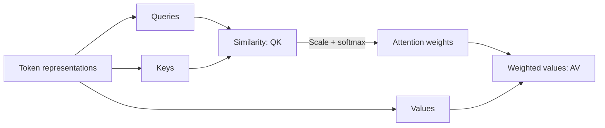
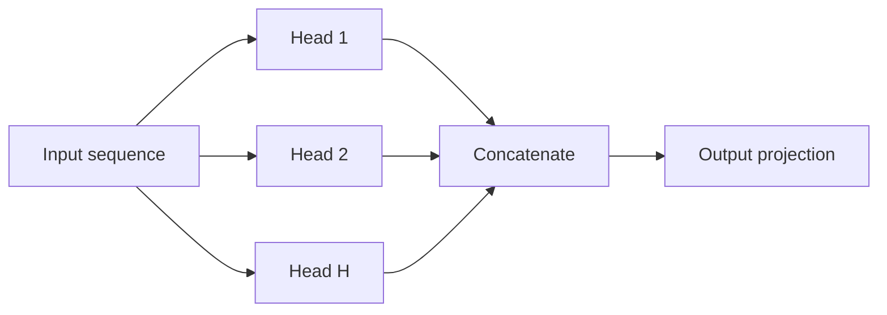
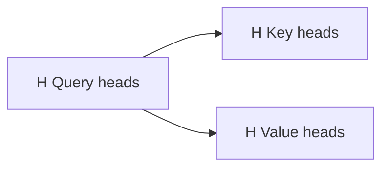
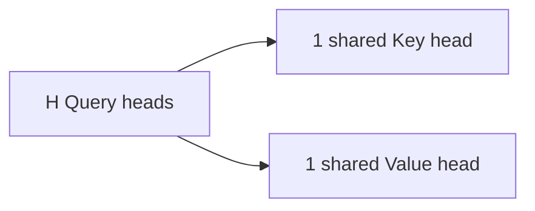
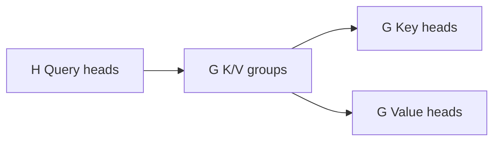

# Attention

Language is inherently contextual. The word *bank* refers to a financial institution in the sentence “I deposited money at the bank,” but to a landform in “We picnicked on the riverbank.” A token's meaning cannot be fully determined in isolation; it depends on the surrounding tokens and the relationships between them.

The central challenge of a sequence model is therefore to enable information to flow between positions in a content-dependent way. Recurrent Neural Networks (RNNs) process information sequentially, which limits parallelism and can make distant information harder to retain.

Attention removes this sequential bottleneck. Any two positions can interact directly within a single operation, and these interactions can be computed in parallel. Scaled across many layers and parameters, this simple mechanism forms the foundation of modern language models.

**Key idea:** Attention updates each token's representation by computing a weighted average of the representations of other tokens. The weights are determined dynamically by the content of the tokens themselves.

## Intuition

A useful mental model for attention is a dictionary, or a key-value store. In a conventional dictionary, you provide a query, compare it against stored keys, and retrieve the value associated with the matching key. Attention makes this process softer and more flexible.

Instead of searching for one exact key, attention compares the query with every key and assigns each one a similarity score. These scores are converted into weights that sum to one, typically using the softmax function. The output is then a weighted combination of the corresponding values.

This soft lookup is trainable. A hard lookup is discontinuous: changing a query may have no effect until the selected key changes. Softmax is smooth and differentiable, so small changes in queries or keys produce gradual changes in the attention weights. Gradient descent can therefore learn better query, key, and value representations.

At its core, attention is a **learnable, differentiable retrieval mechanism** that allows a model to selectively gather information from across a sequence based on content.

## Scaled Dot-Product Attention

The source of \(Q\), \(K\), and \(V\) determines the type of attention:

- **Self-attention:** all three are projected from the same sequence. This is the main attention mechanism in decoder-only language models.
- **Cross-attention:** \(Q\) comes from one sequence, while \(K\) and \(V\) come from another. For example, decoder tokens in a translation model can attend to encoder outputs.

The scaled dot-product attention mechanism is defined as:

$$
\operatorname{Attention}(Q,K,V)
=
\operatorname{softmax}
\left(
\frac{QK^\top}{\sqrt{d_k}}
\right)V
$$

The computation has four steps:

1. **Score** — Compute the similarity matrix $S = QK^\top$. The resulting $N \times N$ matrix contains the alignment scores between every query and every key. Entry $S_{ij}$ measures how strongly token $i$'s query aligns with token $j$'s key. A larger dot product generally indicates greater similarity, making the score a measure of relevance.

2. **Scale** — Divide every score by $\sqrt{d_k}$, giving $S_{\text{scaled}} = \frac{QK^\top}{\sqrt{d_k}}$. This prevents dot-product scores from growing too large as the key dimension increases, helping maintain stable gradients during training.

3. **Normalize** — Apply softmax along each row: $A = \operatorname{softmax}\left(\frac{QK^\top}{\sqrt{d_k}}\right)$. Softmax converts the scores into non-negative attention weights that sum to 1 along each row. Each row therefore represents a probability distribution over the tokens that a given token should attend to.

4. **Mix** — Multiply the attention weight matrix by the value matrix: $O = AV$. The output row $O_i$ is a weighted combination of the value vectors, with weights determined by the attention distribution for token $i$. This allows each token to selectively gather information from other tokens in the sequence.



## Causal Attention

Causal attention prevents a token from attending to tokens that appear later in the sequence. This is required for autoregressive generation, where the model predicts the next token from only the preceding tokens.

The causal mask adds \(-\infty\) to future positions before softmax:

\[
M_{ij}
=
\begin{cases}
0, & j \le i\\
-\infty, & j > i
\end{cases}
\]

\[
A=\operatorname{softmax}\left(\frac{QK^\top}{\sqrt{d_k}}+M\right)
\]

The resulting attention pattern is lower triangular:

```text
          Keys
        x1  x2  x3  x4
x1       ✓   ✗   ✗   ✗
x2       ✓   ✓   ✗   ✗
x3       ✓   ✓   ✓   ✗
x4       ✓   ✓   ✓   ✓
```

A bidirectional encoder may allow both directions; a causal decoder allows only the current and preceding positions.


## Multi-Head Attention

A single attention operation uses one attention distribution per token to determine how information from other tokens should be gathered. However, language contains multiple kinds of relationships simultaneously, such as subject–verb agreement, coreference, syntactic dependencies, and positional relationships.

These relationships may require attending to different tokens. A single attention distribution may struggle to represent all of them effectively. Multi-Head Attention (MHA) addresses this limitation by performing multiple attention operations in parallel. Each attention head has its own learned Query, Key, and Value projections, allowing it to learn a different way of relating tokens.

Rather than forcing all relationships into one shared attention pattern, MHA lets different heads learn complementary patterns of information retrieval.



### Mathematical formulation

Given an input sequence represented by a matrix \(X \in \mathbb{R}^{N \times d_{\text{model}}}\), each attention head computes \(Q_h = XW_h^Q\), \(K_h = XW_h^K\), and \(V_h = XW_h^V\) using independent learned projection matrices.

For head \(h\), scaled dot-product attention is computed as:

$$
\operatorname{head}_h =
\operatorname{softmax}
\left(
\frac{Q_hK_h^\top}{\sqrt{d_k}}
\right)V_h
$$

Here, \(d_k\) is the dimensionality of the Query and Key vectors in each head. The softmax is applied row-wise, producing an attention distribution for every token.

With \(H\) attention heads, the outputs are concatenated along their feature dimension: \(\operatorname{Concat}(\operatorname{head}_1,\ldots,\operatorname{head}_H)\).

The concatenated representation is then passed through a final learned output projection:

$$
\boxed{
\operatorname{MHA}(X)
=
\operatorname{Concat}
(\operatorname{head}_1,\ldots,\operatorname{head}_H)
W^O
}
$$

where \(W^O\) is the output projection matrix.

### How the output is actually formed

Suppose the model has four attention heads. Each head processes the same input sequence, but with different learned projections.

- **Head 1** may learn to focus on syntactic relationships.
- **Head 2** may learn to connect pronouns with their antecedents.
- **Head 3** may focus on nearby tokens.
- **Head 4** may capture another useful contextual relationship.

These are illustrative examples; heads are not explicitly assigned these roles and may learn overlapping patterns.

Each head produces an output matrix containing one updated representation per token. For a particular token, the output of each head is a vector containing the information that head retrieved from the sequence.

The outputs are not averaged. Instead, they are **concatenated** to preserve the information from each head:
\(z_i = \operatorname{Concat}(z_i^{(1)},z_i^{(2)},\ldots,z_i^{(H)})\).

The concatenated vector is then multiplied by the output projection matrix: \(y_i = z_iW^O\).

This final projection mixes information across the heads and transforms the concatenated vector back into the model's representation dimension.

The result is a single updated representation for each token, combining information retrieved through multiple attention patterns.

### Why multiple heads are computationally efficient

In the standard Transformer configuration, the model dimension is divided across the attention heads. If the model dimension is \(d_{\text{model}}\), the head dimension is typically \(d_k = d_v = d_{\text{model}}/H\).

For example, with \(d_{\text{model}}=512\) and \(H=8\), each head uses a dimension of \(64\).

The heads operate in parallel, and their combined projection dimensions remain equal to the model dimension: \(H \times d_k = d_{\text{model}}\).

This allows the model to obtain multiple attention patterns without multiplying the main attention computation by the number of heads compared with a single full-dimensional attention operation. The standard multi-head projections have a similar overall parameter and computation scale to a single attention layer with the same model dimension.

**In essence:** Multi-Head Attention lets each token gather information through several learned attention patterns, concatenates the resulting representations, and uses a final linear projection to combine them into one contextual representation.

## Types of Attention

MHA, MQA, and GQA use the same scaled dot-product attention equation, but organize the Query, Key, and Value heads differently.

- **MHA:** Every Query head has its own Key and Value head.
- **MQA:** All Query heads share one Key and Value head.
- **GQA:** Groups of Query heads share a Key and Value head.

This design primarily affects the amount of Key-Value memory required during autoregressive generation, especially when the model uses a KV cache.

### Multi-Head Attention (MHA)

In MHA, each attention head has its own Query, Key, and Value projection matrices. Every head independently computes attention over the input sequence.



For \(H\) heads:

\(Q_h = XW_h^Q\), \(K_h = XW_h^K\), and \(V_h = XW_h^V\).

Each head computes:

$$
\operatorname{head}_h =
\operatorname{softmax}
\left(
\frac{Q_hK_h^\top}{\sqrt{d_k}}
\right)V_h
$$

The outputs of all heads are concatenated and projected:

$$
\operatorname{MHA}(X)
=
\operatorname{Concat}
(\operatorname{head}_1,\ldots,\operatorname{head}_H)
W^O
$$

**Key characteristic:** Each head has independent Keys and Values, allowing every head to learn its own attention representation.

For example, with 8 Query heads, MHA has 8 Key heads and 8 Value heads.

### Multi-Query Attention (MQA)

MQA reduces memory usage by sharing a single Key head and a single Value head across all Query heads.



Instead of having separate Key and Value projections for every head, MQA uses:

\(Q_h = XW_h^Q\), \(K = XW^K\), and \(V = XW^V\).

Every Query head attends to the same Key and Value matrices:

$$
\operatorname{head}_h =
\operatorname{softmax}
\left(
\frac{Q_hK^\top}{\sqrt{d_k}}
\right)V
$$

The output is still formed by concatenating all Query-head outputs and applying the output projection:

$$
\operatorname{MQA}(X)
=
\operatorname{Concat}
(\operatorname{head}_1,\ldots,\operatorname{head}_H)
W^O
$$

**Key characteristic:** Multiple Query heads share one Key head and one Value head.

For example, with 8 Query heads, MQA has only 1 Key head and 1 Value head.

This significantly reduces the amount of Key-Value data that must be stored in the KV cache during generation.

### Grouped-Query Attention (GQA)

GQA is a compromise between MHA and MQA. Query heads are divided into groups, and each group shares one Key head and one Value head.



Let:

- $H$ be the number of Query heads.
- $G$ be the number of Key-Value groups.
- $r = H/G$ be the number of Query heads per group.

For group $g$, compute the shared Key and Value projections:

\(K_g = XW_g^K\) and \(V_g = XW_g^V\).

Each Query head $h$ belonging to group $g$ uses that group's Key and Value:

$$
\operatorname{head}_h =
\operatorname{softmax}
\left(
\frac{Q_hK_g^\top}{\sqrt{d_k}}
\right)V_g
$$

The final output is:

$$
\operatorname{GQA}(X)
=
\operatorname{Concat}
(\operatorname{head}_1,\ldots,\operatorname{head}_H)
W^O
$$

**Key characteristic:** Query heads share Keys and Values within groups, but different groups have their own Key and Value representations.

For example, with 8 Query heads and 2 Key-Value groups, each group contains 4 Query heads.

### Comparison

| Feature | MHA | MQA | GQA |
|---|---:|---:|---:|
| Query heads | H | H | H |
| Key heads | H | 1 | G |
| Value heads | H | 1 | G |
| KV sharing | None | All heads | Within groups |
| KV cache size | Largest | Smallest | Intermediate |
| Attention flexibility | Highest | More constrained | Balanced |

### Why does this matter for inference?

During autoregressive generation, a Transformer stores previously computed Keys and Values in a **KV cache** so it does not need to recompute them for every new token.

The approximate KV cache memory is proportional to:

$$
2 \times L \times N \times G \times d_k
$$

where:

- $L$ is the number of Transformer layers.
- $N$ is the sequence length.
- $G$ is the number of Key-Value heads.
- $d_k$ is the dimension of each Key or Value head.
- The factor 2 accounts for storing both Keys and Values.

For MHA, $G=H$. For MQA, $G=1$. For GQA, $1<G<H$.

Therefore, MQA and GQA can reduce KV cache memory and memory bandwidth requirements, often improving generation speed. GQA is particularly useful because it retains multiple distinct Key-Value groups while still reducing cache size substantially.

## Cost and Connections

As Transformer models process increasingly longer sequences, the computational cost of attention becomes a major challenge. The main issue is that standard attention requires interactions between every pair of tokens, resulting in quadratic growth in computation and memory.

Several approaches have been developed to address this limitation. These include sliding window attention, strided attention, and linear/kernel attention.

To understand why these approaches matter, we also need to examine arithmetic intensity, which helps explain how efficiently hardware performs these computations.

### Attention Time Complexity

The computational complexity of standard self-attention is \(O(N^2d)\).

where:

- \(N\) = sequence length.
- \(d\) = hidden dimension.

The quadratic term \(N^2\) comes from computing interactions between all pairs of tokens.

For example, consider a sequence of 1,000 tokens. The attention computation involves approximately one million token-pair interactions.

If the sequence length increases to 2,000, the number of interactions becomes approximately four million.

Therefore, doubling the sequence length results in approximately four times the attention computation.

#### Computational and Memory Costs

Standard attention has two important costs:

**Time complexity:** \(O(N^2d)\).

**Memory complexity:** \(O(N^2)\).

The memory complexity comes from storing the attention score or probability matrix when it is explicitly materialized.

This becomes particularly expensive when processing long documents, large contexts, or high-resolution inputs.

The primary objective of efficient attention mechanisms is to reduce these costs while preserving useful information flow between tokens.

### Sliding Window Attention

Sliding Window Attention reduces computational cost by restricting each token to attending only to a fixed number of neighboring tokens.

Instead of considering the entire sequence, each token operates within a local window of size \(w\).

As the sequence progresses, the window shifts forward, allowing the model to process the entire sequence through overlapping local regions.

#### Example

Consider a sequence of eight tokens: \([x_1,x_2,x_3,x_4,x_5,x_6,x_7,x_8]\).

Suppose the window size is four and attention is causal.

The attention pattern looks like this:

| Token | Tokens it can attend to |
|---|---|
| \(x_1\) | \(x_1\) |
| \(x_2\) | \(x_1,x_2\) |
| \(x_3\) | \(x_1,x_2,x_3\) |
| \(x_4\) | \(x_1,x_2,x_3,x_4\) |
| \(x_5\) | \(x_2,x_3,x_4,x_5\) |
| \(x_6\) | \(x_3,x_4,x_5,x_6\) |
| \(x_7\) | \(x_4,x_5,x_6,x_7\) |
| \(x_8\) | \(x_5,x_6,x_7,x_8\) |

#### Complexity

Standard attention:

Standard attention is \(O(N^2d)\); sliding window attention is \(\boxed{O(Nwd)}\).

Here, \(w\) is the fixed window size.

When \(w\) is significantly smaller than \(N\), the computational complexity becomes linear with respect to sequence length.

#### Advantages

- Reduces computation and memory requirements.
- Efficient for long sequences.
- Preserves local contextual relationships.
- Allows overlapping windows to propagate information across the sequence.

#### Limitations

- Tokens cannot directly interact with distant tokens outside their windows.
- Long-range information may require multiple layers to propagate.
- Performance depends on selecting an appropriate window size.

**Key idea:** Sliding window attention trades unrestricted global connectivity for efficient local connectivity.

### Strided Attention

Strided Attention reduces the number of token interactions by selecting tokens at regular intervals rather than considering every position.

The interval between selected positions is called the stride.

For example, with a stride of two, the model selects every second position: \([x_1,x_3,x_5,x_7,\ldots]\).

This allows the model to obtain information from a wider region while reducing the number of positions considered.

#### How Does It Work?

Suppose we have a sequence of eight tokens: \(X=[x_1,x_2,x_3,x_4,x_5,x_6,x_7,x_8]\).

With a stride of two, a token may attend to selected positions at intervals of two rather than attending to all eight positions.

This creates a sparse attention pattern.

Unlike sliding window attention, which focuses on consecutive neighboring tokens, strided attention distributes attention across positions at regular intervals.

#### Complexity

If each token attends to approximately \(N/s\) positions, where \(s\) is the stride:

\[
\boxed{O\left(\frac{N^2d}{s}\right)}
\]

This describes a pattern where each query considers roughly \(N/s\) keys.

The exact complexity depends on how the strided pattern is implemented.

#### Advantages

- Reduces the number of attention interactions.
- Provides access to information distributed across a wider sequence.
- Can complement local attention patterns.

#### Limitations

- Intermediate positions may not be directly considered.
- Important local information can be missed.
- Performance depends on the stride and attention pattern.

**Key idea:** Sliding window attention focuses on nearby consecutive tokens, whereas strided attention samples positions at regular intervals.

### Linear and Kernel Attention

Linear Attention aims to reduce the quadratic complexity of standard attention to linear complexity with respect to sequence length.

The main idea is to change how attention is mathematically computed so that we do not need to construct the complete \(N \times N\) attention matrix.

#### Standard Attention Computation

Ignoring softmax notation temporarily, consider the matrix multiplication order:

\[
(QK^T)V
\]

First, we calculate \(QK^T\).

This produces an \(N \times N\) matrix, resulting in quadratic complexity with respect to sequence length.

#### Linear Attention Computation

Using the associativity of matrix multiplication, we can rearrange the computation as \(Q(K^TV)\).

Instead of first calculating the interaction between every pair of tokens, we calculate \(K^TV\).

Then multiply the result by \(Q\).

This changes the order of computation and can avoid constructing the large \(N \times N\) matrix.

For suitable dimensions, the resulting computation has complexity \(\boxed{O(Nd^2)}\). For fixed feature dimension \(d\), this is linear in sequence length: \(\boxed{O(N)}\).

However, this algebraic rearrangement alone does not make conventional softmax attention linear. Softmax must also be handled appropriately.

#### Kernel Attention

Kernel Attention provides one approach to achieving this.

The central idea is to represent similarity between two vectors using a feature map: \(K(q,k)\approx \phi(q)^T\phi(k)\).

Where:

- \(K(q,k)\) represents the similarity function.
- \(\phi(q)\) represents the transformed query.
- \(\phi(k)\) represents the transformed key.

Using this representation, attention can be reorganized to avoid explicitly constructing the full pairwise similarity matrix.

A simplified kernel attention expression is:

\[
O_i=
\frac{
\phi(q_i)^T
\left(\sum_j \phi(k_j)v_j^T\right)
}{
\phi(q_i)^T
\left(\sum_j \phi(k_j)\right)
}
\]

The summations can be computed and reused across queries.

This reduces the dependence on sequence length from quadratic to linear for a fixed feature dimension, subject to the chosen kernel and implementation.

#### Advantages

- Avoids explicitly constructing the full attention matrix.
- Reduces sequence-length-dependent computational cost.
- Can reduce memory requirements.
- Useful for applications involving very long sequences.

#### Limitations

- May approximate or otherwise change the behavior of standard softmax attention.
- The choice of feature map affects performance.
- Numerical stability and implementation details are important.
- Not every linear attention implementation provides the same quality as standard attention.

**Key idea:** Linear and kernel attention change the mathematical computation to avoid explicitly calculating all pairwise token interactions.

### Arithmetic Intensity

Arithmetic Intensity is an important concept in understanding the hardware efficiency of attention mechanisms.

It measures how much computation is performed relative to the amount of data transferred between memory and the processor.

It is defined as:

\[
\boxed{
Arithmetic\ Intensity=
\frac{\text{Number of floating-point operations (FLOPs)}}
{\text{Bytes of data transferred}}
}
\]

Its unit is:

\[
FLOPs/Byte
\]

#### Why Does Arithmetic Intensity Matter?

Modern GPUs have two important performance characteristics:

1. **Compute throughput:** How many mathematical operations the GPU can perform per second.
2. **Memory bandwidth:** How quickly data can be transferred between memory and the GPU's processing units.

A computation may be limited by either of these resources.

#### Compute-Bound Operations

These operations perform a large number of mathematical calculations relative to the amount of data transferred.

They primarily depend on the GPU's computational throughput.

#### Memory-Bound Operations

These operations transfer a relatively large amount of data compared with the number of calculations performed.

Their performance is primarily limited by memory bandwidth.

#### Arithmetic Intensity in Attention

Attention involves large matrix multiplications as well as operations such as softmax and intermediate tensor movement.

Matrix multiplication can achieve relatively high arithmetic intensity because data can be reused across many calculations.

However, materializing and repeatedly reading or writing the attention matrix introduces additional memory traffic.

This can make attention memory-bound, particularly for long sequences.

#### Roofline Model

The Roofline Model is used to understand whether an operation is compute-bound or memory-bound.

The achievable performance can be approximated as:

\[
Performance=
\min(
Peak\ Compute,
Arithmetic\ Intensity \times Memory\ Bandwidth
)
\]

This gives us two possible limits:

- When arithmetic intensity is low, memory bandwidth limits performance.
- When arithmetic intensity is high, computational throughput becomes the limiting factor.

#### Why Is This Important for Efficient Attention?

Reducing FLOPs alone does not necessarily make an attention implementation faster.

An algorithm may perform fewer calculations but require frequent memory transfers, reducing its practical performance.

This is why modern attention optimizations focus on both computational complexity and memory efficiency.

For example, FlashAttention uses tiling and recomputation strategies to reduce memory traffic and avoid materializing the complete attention matrix in high-bandwidth memory.

Although it retains the exact standard attention computation (up to floating-point numerical differences), it improves hardware efficiency through better memory management.

**Key idea:** Arithmetic intensity helps explain why reducing memory movement can be just as important as reducing the number of mathematical operations.

### Comparison of Attention Mechanisms

| Attention mechanism | Computational complexity | Main idea |
|---|---|---|
| Standard attention | \(O(N^2d)\) | All-to-all interactions |
| Sliding window attention | \(O(Nwd)\) | Local neighboring interactions |
| Strided attention | \(O(N^2d/s)\)* | Regularly sampled interactions |
| Linear attention | \(O(Nd^2)\)** | Reorganized computation |
| Kernel attention | Typically \(O(Ndr)\)*** | Feature-map-based similarity |

\* Assumes approximately \(N/s\) selected keys per query.

\** Assumes suitable dimensions and an implementation that avoids the full pairwise matrix.

\*** Here, \(r\) is the feature-map dimension, assuming the relevant dimensions and feature-map computation are fixed.

#### Final Takeaway

Efficient attention is not just about reducing the number of mathematical operations. It is also about controlling memory usage and making better use of hardware resources.

- **Sliding Window Attention** reduces interactions by restricting attention to local neighborhoods.
- **Strided Attention** reduces interactions through regularly spaced positions.
- **Linear Attention** changes the computation order to avoid quadratic pairwise interactions.
- **Kernel Attention** uses feature maps to obtain an efficient representation of similarity.
- **Arithmetic Intensity** explains the relationship between computation and memory movement, helping us understand real-world hardware performance.

Together, these techniques provide different ways to make Transformer models more efficient, particularly when working with long sequences.