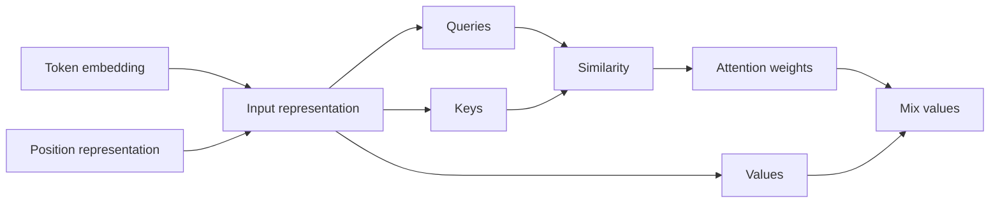
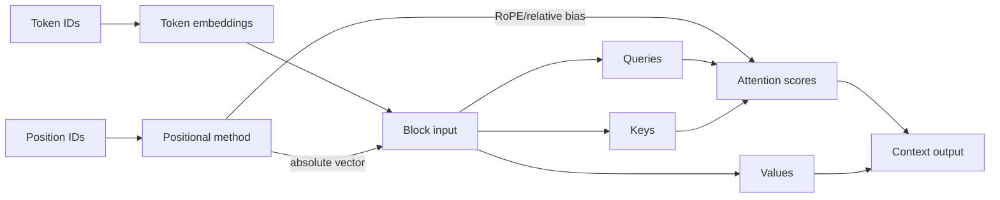

# Positional Embeddings

Attention makes a Transformer more flexible than a recurrent network: every token can interact with every other token without being processed in a fixed temporal loop. It also makes the model largely insensitive to the order of tokens.

Given the same unordered set of representations, standard dot-product attention computes the same pairwise relationships. If the input sequence is permuted and the queries and keys are permuted with it, the resulting attention outputs are permuted with it too. The network has no built-in notion of which token came first, second, or next to which.

This property is useful in some settings, but language depends heavily on order:

- `the cat chased the dog` has a different meaning from `the dog chased the cat`
- `not good` differs from `good`
- a definition that appears in one section may refer to a recent mention or to a distant earlier one
- in code, operator and argument positions can determine structure

Positional embeddings provide the missing information. They encode position or relative displacement in vectors that enter the Transformer along with token representations.

**Key idea:** Position information is not an alternative to attention. It changes the representations or similarity computation that attention receives, allowing content and position to interact.

## The Core Problem

Let \(X \in \mathbb{R}^{N \times d_{\text{model}}}\) contain token representations after embedding lookup and, in a typical implementation, after other input normalization. The model must decide how to use both token identity and position.

A simple but incorrect approach is to rely on the integer position:

\[
x_i = E[t_i] + i
\]

This is usually unsuitable because the scale of raw indices has no natural relationship to learned embedding dimensions, and adding an arbitrary scalar to every feature makes the representation depend on a coordinate convention.

The standard approach is to map a position to a vector:

\[
z_i = E[t_i] + P_i
\]

where \(P_i \in \mathbb{R}^{d_{\text{model}}}\) is a position representation. The vector \(P_i\) can be learned, generated by a fixed formula, or integrated directly into attention.

The dominant distinction is between:

- **Absolute methods**, which represent position \(i\), such as an embedding \(P_i\)
- **Relative methods**, which represent displacement \(i-j\), such as \(P_{i-j}\) or a scalar bias
- **Indirect methods**, which omit an explicit \(P_i\) but construct position-dependent behavior through training and architecture

These labels describe the implementation, not the only information the model can learn to recover. A model with absolute embeddings can learn relative patterns. A model with relative embeddings can still represent absolute content if its training data gives it enough structure.

## Why Attention Needs Position

For scaled dot-product attention,

\[
A_{ij}
=
\operatorname{softmax}_{j}
\left(
\frac{q_i^\top k_j}{\sqrt{d_k}}
\right)
\]

\[
o_i=\sum_j A_{ij}v_j
\]

The position of token \(i\) can affect:

- \(q_i\), if position is added before query projection
- \(k_j\), if position is added before key projection
- \(v_j\), if position is added before value projection
- the attention score directly, for example with relative position terms
- both attention and value behavior in more elaborate designs

In the common absolute-position design,

\[
z_i = x_i^{\text{token}}+P_i
\]

\[
q_i=z_iW^Q,\qquad
k_j=z_jW^K,\qquad
v_j=z_jW^V
\]

Position consequently changes all three representations. However, position is not multiplied or gated separately. It participates in learned linear projections, where it can interact with token content.

For instance,

\[
q_i^\top k_j
=
(x_iW^Q+P_iW^Q)^\top
(x_jW^K+P_jW^K)
\]

expands into token-token, token-position, position-token, and position-position terms. These terms provide four possible channels through which position can alter which tokens retrieve each other.



## Sinusoidal Positional Embeddings

The original Transformer used a fixed sinusoidal embedding for every position. The vector for position \(i\) has components

\[
P(i,2k)=\sin\left(\frac{i}{10000^{2k/d_{\text{model}}}}\right)
\]

\[
P(i,2k+1)=\cos\left(\frac{i}{10000^{2k/d_{\text{model}}}}\right)
\]

where \(k\) indexes pairs of dimensions.

The wavelengths vary geometrically:

- low-index dimension pairs oscillate rapidly
- high-index dimension pairs oscillate slowly
- the position representation therefore resembles a mixed-resolution clock or phase code

The key result is that neighboring positions receive similar vectors, while sufficiently distant positions occupy different combinations of phases. The representation is deterministic and does not require a separate learned parameter table.

### Linear displacement property

For each frequency, sine and cosine values can be interpreted as coordinates in a two-dimensional rotation:

\[
\begin{bmatrix}
\cos(\omega(i+\delta))\\
\sin(\omega(i+\delta))
\end{bmatrix}
=
\begin{bmatrix}
\cos(\omega\delta)&-\sin(\omega\delta)\\
\sin(\omega\delta)&\cos(\omega\delta)
\end{bmatrix}
\begin{bmatrix}
\cos(\omega i)\\
\sin(\omega i)
\end{bmatrix}
\]

Thus, moving a position by a fixed offset \(\delta\) corresponds to a rotation in each sine/cosine pair. The same displacement yields the same local transformation regardless of the starting absolute position.

This property is one reason sinusoidal embeddings were expected to generalize to positions outside the training range. It is a useful inductive bias, but it does not guarantee that projected attention behavior will extrapolate perfectly.

### A small example

Suppose a model uses only four pairs of dimensions with four angular frequencies. Position \(0\) is

\[
P_0=[\sin 0,\cos 0,\sin 0,\cos 0,\ldots]
=[0,1,0,1,\ldots]
\]

Position \(1\) differs in every frequency according to:

\[
\sin(\omega_k),\qquad \cos(\omega_k)
\]

The nearest positions are not identical, but they share several slow-varying components. A larger offset produces a different phase mixture.

Sinusoidal embeddings are rarely a complete solution by themselves in modern decoder-only models. Nonetheless, they demonstrate an important design principle: positions can be represented through structured continuous functions rather than only as table rows.

## Learned Absolute Positional Embeddings

A learned absolute positional embedding uses a table:

\[
P=\begin{bmatrix}
P_0\\
P_1\\
\vdots\\
P_{L_{\max}-1}
\end{bmatrix}
\in\mathbb{R}^{L_{\max}\times d_{\text{model}}}
\]

For position \(i\), the model uses row \(P_i\), as with token embeddings.

The table adds \(L_{\max}d_{\text{model}}\) parameters. Every row is optimized from training examples that expose the model to that position. This often works well on fixed-length or bounded-context tasks.

### Strengths

- Straightforward to implement
- Flexible: training can discover patterns relevant to the exact task
- Compatible with encoder and decoder architectures
- Performs well when expected context lengths match training

### Limits

The position \(i\) is not a parameter-independent geometric quantity. If the model saw position \(100\) rarely during training, there may be little useful data for learning \(P_{100}\).

During generation, a position outside \([0,L_{\max}-1]\) has no table row unless the implementation dynamically interpolates or extends positions. A common failure is to configure the model for a larger context window only to discover that its position table or attention implementation cannot accept the new positions.

Learned embeddings can also encourage absolute layout biases. A model trained with document titles, fixed prompts, or a rigid chat template may associate information with particular absolute positions.

## Relative Positional Representations

Absolute embeddings answer: “What is the position of this token?”

Relative methods answer: “How far and in which direction is token \(j\) from token \(i\)?"

This distinction is useful because many linguistic relationships depend on displacement rather than the absolute document coordinate:

- the subject and verb in a nearby clause
- a parenthesis referring to an immediately previous expression
- a word within \(k\) tokens of the current token
- the previous turn in a conversation

In self-attention, relative position can be incorporated by modifying the score:

\[
S_{ij}
=
\frac{(x_iW^Q)^\top(x_jW^K)}
{\sqrt{d_k}}
+
\text{relative term}
\]

One popular form adds learned key-dependent and value-dependent terms:

\[
S_{ij}
=
\frac{(x_iW^Q)^\top(x_jW^K)}
{\sqrt{d_k}}
+
\frac{(x_iW^Q)^\top r_{ij}^K}{\sqrt{d_k}}
\]

\[
o_i
=
\sum_j A_{ij}
\left(
x_jW^V+r_{ij}^V
\right)
\]

Here, \(r_{ij}\) is a representation of relative displacement. It may come from a learned table, for example \(R_{i-j}\), or from a fixed or computed feature.

Relative methods are not necessarily cheaper to implement. Some require a loop or reshape over relative offsets and can increase memory or implementation complexity. Efficient implementations exploit Toeplitz-like or block structures.

### Clipping Relative Offsets

An exact displacement table can have an entry for every possible offset. A model with context length \(L\) has positions from \(-L+1\) through \(L-1\).

Many implementations clip offsets:

\[
\operatorname{clip}(i-j,-K,K)
\]

The model learns embeddings for a small set of nearby offsets and one or two boundary classes for all farther distances.

This reduces parameter count and encourages distant positions to share a representation. It also changes the meaning of “distance”: offsets larger than \(K\) are not distinguished from one another.

## Rotary Position Embeddings

Rotary Position Embedding (RoPE) does not merely add a positional vector to token content. It rotates pairs of query and key features as functions of position.

For a feature pair at position \(i\), RoPE applies:

\[
\operatorname{RoPE}(u,i)
=
R(i,\theta)u
\]

For a pair \((u_1,u_2)\), the 2D rotation is

\[
\begin{bmatrix}
u_1'\\
u_2'
\end{bmatrix}
=
\begin{bmatrix}
\cos(i\theta)&-\sin(i\theta)\\
\sin(i\theta)&\cos(i\theta)
\end{bmatrix}
\begin{bmatrix}
u_1\\
u_2
\end{bmatrix}
\]

The head dimension is divided into pairs, and each pair can use a different angular frequency:

\[
\theta_k=b^{-2k/d}
\]

for an implementation-specific base \(b\), with \(d\) the Query/Key head dimension.

For example, with

\[
q_i=R_iq,\qquad k_j=R_jk
\]

the dot product becomes

\[
(R_iq)^\top(R_jk)
=
q^\top R_i^\top R_j k
=
q^\top R_{j-i}k
\]

This is an important result: applying rotations at each position makes the dot product depend on a relative rotation of \(j-i\), even though the implementation constructs \(q_i\) and \(k_j\) from absolute positions.

### Complex-number view

Pairing real feature dimensions as complex values gives a compact expression:

\[
\operatorname{RoPE}(u,i)=u e^{i\omega i}
\]

The pairwise dot product is a sum of terms associated with the relative phase:

\[
\operatorname{Re}(u_i\cdot \overline{u_j}e^{i\omega(j-i)})
\]

This helps explain why RoPE combines absolute position in the representation with relative positional structure in attention.

### RoPE only in Queries and Keys

RoPE is normally applied to Query and Key vectors, not Value vectors. The reason is that rotation gives the attention score a relative positional structure:

\[
S_{ij}=(R_iq_i)^\top(R_jk_j)
\]

Values remain content representations and are attended to according to those scores. This is a different design from adding \(P_i\) to every token, which directly perturbs Value representations too.

### RoPE frequency and wavelength

For frequency \(\theta_k=b^{-2k/d}\), the wavelength is

\[
\lambda_k=\frac{2\pi}{\theta_k}
\]

Low frequencies rotate slowly and may encode distance over a long context. High frequencies rotate quickly and distinguish nearby positions. The frequency spacing determines how fine-grained and how distant positional distinctions can be.

Changing the base, for example from one conventional value to a larger one, changes the wavelength distribution. This is sometimes used to improve long-context behavior, but it also changes phase relationships across all dimensions.

### KV cache and RoPE

During autoregressive generation, an existing cached Key for position \(j\) is already stored as \(R_jk_j\). The new Query at position \(i\) is computed as \(R_iq_i\).

This makes RoPE cache-friendly: there is no need to recompute earlier positions when the model advances, except for implementations that resize or remap positions during context extension.

However, the cache itself is a history of positions. Reusing a cache after inserting or deleting chat messages, packing unrelated sequences, or changing position IDs can give stale or semantically incorrect location information.

### RoPE extrapolation

RoPE can have useful out-of-range behavior because rotations are defined for arbitrary positions. This does not mean that every angle or context length is equivalent.

As position grows, high-frequency feature pairs oscillate many times. A model trained only to roughly \([0,L_{\text{train}}]\) may encounter phase patterns at the next interval that it has little reason to interpret consistently.

Several families of long-context adaptations alter RoPE:

- **Position interpolation:** map \([0,L_{\text{target}}]\) into the range seen during training
- **Frequency scaling:** adjust low-frequency components more strongly than high-frequency components
- **NTK-style scaling:** change the effective frequency distribution
- **Dynamic or extension strategies:** choose a scaling rule based on the realized context length

These methods trade positional fidelity for stability outside the training range. Scaling down position can make distant positions easier to recognize but compresses distinctions among nearby positions.

## ALiBi

Attention with Linear Biases (ALiBi) omits an additive positional vector. It changes the attention score with a head-specific linear penalty based on distance:

\[
S_{ij}
=
q_i^\top k_j
-
m_h|i-j|
\]

where \(m_h>0\) is a fixed slope for attention head \(h\). Causal attention makes the relevant offsets negative or zero:

\[
S_{ij}=q_i^\top k_j-m_h(i-j)
\]

for \(j\le i\).

Each head receives a different slope. Some heads decay attention quickly with distance, while others maintain a comparatively broad view.

ALiBi is particularly simple in implementation:

- no learned position embedding table
- no position vectors added to token representations
- no explicit rotational transform
- the bias is only a function of \(i-j\) and the head

The relative penalty is also linear, so adding context generally creates a predictable penalty extension rather than introducing a new learned absolute-position row.

### Strengths

- No absolute position parameter table
- Easy to implement on causal self-attention
- Reuses the Key and Value mechanism unchanged
- Often produces a useful inductive bias toward local context

### Limits

- The linear bias shape may be too rigid for some tasks
- Distances farther than the training range can receive increasingly extreme penalties
- The method is primarily natural for causal or relative-distance settings
- It does not encode rich cyclic or multi-frequency positional features

ALiBi demonstrates that useful position information does not have to come in the form of vectors. A scalar bias added to every pair is enough to give attention a distance preference.

## Relative Biases and Position Buckets

Before or alongside RoPE and ALiBi, several models use learned relative position bias tables. T5-style designs bucket offsets into intervals and add a learned bias:

\[
S_{ij}=
\frac{q_i^\top k_j}{\sqrt{d_k}}
+
B_h[b(i-j)]
\]

where \(b(\cdot)\) maps an exact displacement to a bucket and \(B_h\) stores a learned scalar per bucket and head.

Near offsets often receive separate buckets, while farther offsets share logarithmically spaced buckets. This is a useful trade-off:

- accurate distinctions are retained nearby
- the number of parameters remains small
- long distances receive coarse distinctions
- no explicit absolute position table is required

The bucket mapping is a hyperparameter. It determines which displacements the model can distinguish from one another and how poorly it generalizes at boundaries.

## Absolute, Relative, and Rotary Methods Compared

| Method | Where position enters | Typical strengths | Typical limitations |
|---|---|---|---|
| Learned absolute | Added to input or hidden representation | Flexible; easy to train | Limited maximum length; absolute-position bias |
| Sinusoidal absolute | Added to input representation | Fixed; extrapolation-friendly in principle | Small direct effect after learned projections? |
| Relative key/value representations | Attention scores and/or Values | Models displacement directly | Implementation and memory complexity |
| RoPE | Rotates Queries and Keys | Relative structure; KV-cache-friendly | Context extension and phase design matter |
| ALiBi | Linear distance bias in attention | Small, simple, no position table | Bias shape is inflexible |
| Position buckets | Lookup into relative-bias table | Compact and flexible | Exact versus bucketed offsets |

The “sinusoidal limitation” in the table is not that the method cannot work. It is that repeated extrapolation depends on the interaction between the fixed frequencies and learned network transformations, not only on the sinusoidal function itself.

## Attention-Only Position Versus Input Position

There are two broad implementation locations:

1. **Add position to the input stream**
2. **Add or rotate position inside attention**

Adding position to the input affects subsequent layers, not only the first attention operation. If position enters before block \(1\), residual streams, normalization, every head, and every feed-forward network can transform it.

If position enters only as a RoPE rotation or ALiBi bias, the representations produced by the first feed-forward block do not contain a simple additive position vector. Later blocks may still learn position-dependent behavior through Keys and Queries that remain influenced by attention.

Neither location is universally better. Input embeddings expose position to every token projection and feed-forward computation. Attention-local mechanisms keep position tied more directly to pairwise relationships.

## Where Positional Information Appears in a Transformer

In a decoder-only model, position is often handled once and reused across layers:



At every Transformer block, the hidden state for a token has already accumulated contextual information. Positional operations may therefore act on representations that mix the token identity with earlier-layer context.

This is why the first-block position vector is not the model's entire positional knowledge. The model can also learn to infer order from the causal mask, token sequence, and the cumulative residual computation.

## No Explicit Positional Embeddings

Some architectures deliberately omit a dedicated positional mechanism. The model may still obtain useful sequence structure through:

- causal masks
- recurrent or convolutional components
- stateful architectures
- data patterns that implicitly encode order
- learned token-specific processing

A causal mask is especially important. It gives each token a one-sided view, so even if the representations themselves are permutation invariant, the order of prefix evaluation is not invisible to the model. However, a causal mask only establishes “before” versus “after”; it does not reliably encode exact distance or reverse ordering.

No-position (NoPE) experiments show that attention and Transformers can learn some positional behavior without explicit positional embeddings. This does not imply that position is unnecessary. It means the model can sometimes construct it through the interaction of token content, residuals, and the causal computation.

## Segment and Block Positions

Real applications often use more position types than a single token coordinate.

### Segment positions

A chat sequence may contain system, user, assistant, and tool messages. Token position alone does not identify which segment a token belongs to.

A segment embedding can encode:

- message role
- turn number
- document section
- speaker identity
- retrieved passage identifier

Segment embeddings are often added alongside token and absolute position embeddings. They can preserve structure that is not obvious from text alone.

### Position IDs

Modern APIs and implementations may pass explicit position IDs instead of assuming every sequence begins at zero.

Explicit position IDs can support:

- packed or batched sequences
- continuation of a cached prefix
- multi-document attention
- custom sequence packing
- resuming generation after adding a prefix

Each use is only as consistent as the model's training. Reusing document-local positions for unrelated chunks can make two documents look like neighboring positions.

### Position resets

Some architectures reset or normalize position when:

- starting a new document
- beginning a new chat turn
- entering an independent sample
- ending a packed sequence

Resetting positions can prevent unrelated text from sharing a context coordinate, but it can remove useful session-level ordering. The application should state which behavior the model was trained to expect.

## Positions in the KV Cache

The KV cache stores past Key and Value representations so generation does not recompute the full prefix.

For an absolute method that adds a position vector to the input, cache entries must correspond to the positions already used. Moving a prefix or assigning new position IDs requires recomputing entries that depend on those positions.

For RoPE, cached Keys contain the rotation for their original position. Appending new tokens uses their stored rotations. The implementation must keep the position mapping aligned with the cache:

- cache index \(j\) should correspond to position \(j\)
- removing a prefix should shift or recompute positions
- multi-sequence caches need one position state per sequence
- sliding-window eviction changes which keys exist, not the coordinates of retained keys

For ALiBi, the bias is recomputed from pair distance. Cached Keys do not need a permanent absolute coordinate, although the cache implementation still needs the current offset for a newly inserted token.

## Context Packing

Packed training places multiple sequences into one tensor batch. Position handling must prevent different examples from interacting.

A standard causal batch solves this through:

- padding and attention masks
- resetting position IDs per packed item
- resetting the causal attention boundary for each item

RoPE, relative methods, and ALiBi all use coordinate differences. If unrelated examples share contiguous indices, a model can incorrectly find them close in position. Position IDs and attention masks must therefore agree.

## Context Window versus Position Capacity

The context window is the maximum sequence span the inference implementation accepts. Position capacity is the range the model was trained or configured to represent.

They are not interchangeable:

- a model may accept position IDs longer than it saw in training
- a model may have a small training context but use extrapolation techniques
- an implementation may support a long cache while the model quality degrades
- a layer may be constrained by position metadata while the hardware could hold a larger cache

Any long-context claim should state the evaluation range, not only the number in a configuration file.

## Length Extrapolation

Extrapolation quality depends on at least four factors:

1. the positional scheme
2. the range of positions seen in training
3. the method used to extend or scale positions
4. the task and whether it needs exact versus approximate order

### Tasks that extrapolate more easily

- local copy and retrieval
- nearby dependencies
- short-distance order
- patterns tied to recent state

### Tasks that extrapolate more poorly

- exact position recall
- navigation or indexing rules
- distant matching across a new context length
- arithmetic and repeated structure at unseen distances
- documents with dependencies that depend on absolute layout

No positional scheme guarantees correct extrapolation. Evaluation should include a held-out range, not just a longer-context perplexity number.

## Numerical Considerations

Position implementations involve floating-point arithmetic. The exact details can matter for large positions.

For sinusoidal embeddings:

- very large positions can increase argument size
- high-frequency dimensions can suffer numerical phase precision
- implementations should use the model's configured dtype consistently

For RoPE:

- cosine and sine tables can be precomputed
- cache or dtype conversion can change precision
- memory layout must match the feature-pair convention
- the inverse or conjugate convention must remain consistent

For learned absolute embeddings:

- row IDs must stay within the table
- dynamic position extension requires an explicit interpolation or mapping policy
- quantization can alter small position features

For ALiBi:

- large offsets create increasingly negative values
- the softmax sees the difference between logits after the bias
- if used with float16, extreme values can affect stability

## Interaction with Normalization

Normalization is sensitive to where position enters the residual stream.

If \(P_i\) is added to token embeddings before LayerNorm, normalization removes some scale and content-position distinctions. The result depends on whether:

\[
\operatorname{LN}(x_i+P_i)
\]

is used or whether

\[
x_i+\operatorname{LN}(P_i)
\]

is used. The latter is not a universal implementation choice and can change the magnitude of position features.

Some architectures add sinusoidal or learned position vectors before normalization. Others apply position only in attention. These differences are architectural details, not interchangeable labels.

## Minimal RoPE Implementation

The following example illustrates the feature-pair rotation for a Query or Key tensor.

```python
import torch


def rotate_pairs(x, base=10000.0):
    # x: (batch, heads, sequence, head_dim)
    # head_dim must be even
    batch, heads, length, head_dim = x.shape
    inv_freq = 1.0 / (
        base ** (torch.arange(0, head_dim, 2, dtype=torch.float32) / head_dim)
    )

    position = torch.arange(length, dtype=torch.float32)
    angle = torch.outer(position, inv_freq)

    cos = angle.cos().to(x.dtype)[None, None, :, :]
    sin = angle.sin().to(x.dtype)[None, None, :, :]

    x1 = x[..., 0::2]
    x2 = x[..., 1::2]

    return torch.stack(
        (
            x1 * cos - x2 * sin,
            x1 * sin + x2 * cos,
        ),
        dim=-1,
    ).flatten(-2)
```

For each pair, the corresponding matrix applies:

\[
\begin{bmatrix}
x_1'\\
x_2'
\end{bmatrix}
=
\begin{bmatrix}
x_1\cos-x_2\sin\\
x_1\sin+x_2\cos
\end{bmatrix}
\]

Production implementations precompute tables, handle device placement, fuse the operation with projections, and manage caching more carefully.

## Implementation Checklist

When reviewing or implementing positional embeddings, verify:

- the position convention is relative to the sequence or absolute in the document
- padding is excluded or masked consistently
- packed sequences receive independent position IDs
- the causal mask and position range agree
- Query and Key feature-pair layouts match the RoPE implementation
- cache entries retain the correct position
- position IDs shift correctly after prefix removal or insertion
- chat or document segment resets match training
- the context extension range is defined and tested
- dtype and numerical precision are consistent
- training and inference use the same base, mapping, or bucket function

A discrepancy in any of these areas can produce behavior that looks like an attention bug even though the attention equation is correct.

## Testing Position Behavior

### Permutation tests

Create an unordered or synthetic sequence and permute tokens without changing their position or mask. The model should not necessarily return identical answers if it was designed for order-sensitive text. The purpose of the test is to confirm that the implementation changes the output with position and is not accidentally identity-invariant.

### Copy tests

Ask the model to copy a token at an exact offset. Evaluate whether the implementation succeeds:

- in nearby positions
- at the middle of the context
- at the maximum training length
- beyond the training length

### Relative-distance tests

Use repeated patterns in which:

- the target is always the next token
- the target is always \(k\) positions away
- the target is absolute at a fixed position

These cases reveal whether the model has learned relative or absolute structure.

### Causal-cache tests

Run the same prompt in:

- a full uncompressed forward pass
- a KV-cached streaming forward pass

Compare logits or token predictions for every prefix. A mismatch indicates a cache, mask, position-ID, or RoPE implementation defect.

### Long-context stress tests

Measure quality rather than only context acceptance:

- perplexity by document position
- retrieval pass rate by needle location
- copy accuracy by offset
- duplicate marker disambiguation
- position-relative arithmetic or indexing

An architecture can accept a 128K context without acting equivalently at 128K. Evaluation must separate memory capacity from usable context.

## Common Misconceptions

- **“Positional embeddings assign a meaning to every token position.”** They provide a representation, but the network learns how to use it.
- **“Relative methods cannot encode absolute position.”** Relative attention can interact with content and prefixes to infer absolute or partially absolute structure.
- **“RoPE is an embedding table.”** RoPE rotates Queries and Keys; it does not store a table of position vectors.
- **“ALiBi has no position information.”** It injects a distance-dependent scalar bias directly into attention.
- **“A longer context window means full-length extrapolation.”** The model may not have trained or calibrated its positional behavior at that range.
- **“Sinusoidal embeddings guarantee extrapolation.”** They provide structure, but learned projections determine observed behavior.
- **“The input always needs a positional vector.”** Attention-local relative methods can work without adding absolute position to embeddings.
- **“Position and token embeddings are independent.”** They interact in every linear projection and residual update.

## Choosing a Positional Strategy

Use learned absolute embeddings when:

- context length is bounded
- training and deployment ranges are similar
- a simple encoder or fixed-size task is the priority

Use sinusoidal embeddings when:

- fixed position vectors are preferred
- there is no position table budget
- a traditional or reproducible baseline is required

Use relative representations or buckets when:

- displacement is more important than absolute location
- the task benefits from distant-position grouping
- the implementation can support efficient relative attention

Use RoPE when:

- a decoder-only model is central
- relative distance should modify Query-Key similarity
- KV caching is important
- a long-context scaling strategy is available

Use ALiBi when:

- simplicity and short implementation overhead matter
- head-specific distance decay is acceptable
- context extension is a priority and linear penalties fit the task

For most modern decoder-only language models, RoPE or another rotary/relative scheme is common, but the choice is not evidence of universal superiority. Encoder architectures, fixed-length tasks, and specialized retrieval or time-series models may benefit from absolute or segment-based schemes.

## Final Takeaway

Positional embeddings solve the order-blindness of attention by representing location or displacement.

- **Absolute embeddings** give each position a learned or fixed vector.
- **Sinusoidal embeddings** encode position through frequency-varying phases.
- **Relative representations** make attention scores depend on displacement.
- **Rotary embeddings** rotate Queries and Keys so dot products reflect relative position.
- **ALiBi** adds a head-specific linear distance penalty to attention.
- **Position buckets** compress offsets into a small learned bias table.
- **Position IDs and segment IDs** carry structural information for batching and generation.

The right design must match the model's training distribution, context length, cache behavior, and task structure. A position mechanism that performs well at 4K tokens may still fail at 32K unless its extrapolation behavior is tested explicitly.
