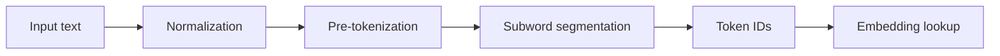
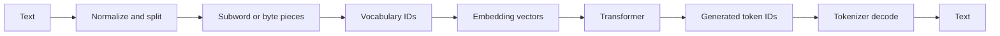

# Tokenization

A language model does not read words, characters, or bytes directly. Before text can enter the model, a tokenizer converts it into a sequence of discrete token IDs. Those IDs select rows from the model's embedding table, and the resulting vectors become the model's input.

This conversion looks like preprocessing, but it is part of the model's interface. It determines which text fragments are atomic, how many positions a piece of text occupies, how unseen strings are represented, and how the model's generated IDs are turned back into text.

**Key idea:** A tokenizer defines a model-specific mapping between text and discrete symbols. The model learns over those symbols, not over human notions of words.

## Why Tokenization Exists

Neural networks operate on numerical tensors. A text string such as `The cat sat.` must therefore be represented as numbers before it can be processed by a Transformer.

A first idea might be to assign one ID to every word. This creates several problems:

- The vocabulary would need to contain every word, name, spelling, and inflection that might appear.
- A new word would have no ID unless a special unknown token were used.
- Rare words would receive little training data despite consuming a vocabulary entry each.
- Punctuation, whitespace, and word boundaries would need consistent treatment.

At the other extreme, representing every character separately gives a small vocabulary but can make sequences very long. It also leaves the model to learn common word and subword patterns across many positions.

Subword tokenization is a practical compromise. Common strings can be represented as single tokens, while uncommon strings can be assembled from smaller pieces. A word such as `unhappiness` might be represented as `un`, `happi`, and `ness`, or as another segmentation chosen by the tokenizer.

The goal is not to discover the one true linguistic segmentation. It is to construct a finite vocabulary that gives a useful balance among:

- **Vocabulary size:** The number of token IDs the model can represent directly.
- **Sequence length:** The number of token positions required to encode text.
- **Coverage:** Whether arbitrary text can be represented without an unknown-token failure.
- **Learnability:** Whether the model sees useful recurring units often enough to learn from them.

## The Tokenization Pipeline

The exact pipeline depends on the tokenizer family, but it commonly includes several conceptual stages:



### Normalization

Normalization transforms text into a chosen canonical form before segmentation. Depending on the tokenizer, it may:

- Normalize Unicode representations.
- Apply or avoid case folding.
- Standardize whitespace.
- Remove or transform selected characters.

Unicode allows visually identical text to have different underlying sequences. For example, an accented letter may be represented as one precomposed code point or as a base letter followed by a combining mark. A normalization policy may make such forms equivalent, or may preserve the distinction.

Normalization affects reversibility. If multiple inputs are transformed to the same normalized string, decoding cannot recover which original spelling was used. Modern tokenizers may preserve text more directly than older word-normalizing pipelines, but the tokenizer's actual rules determine what is preserved.

### Pre-tokenization

Pre-tokenization divides text into initial regions that the subword algorithm processes. These regions might be words, punctuation runs, whitespace-bearing chunks, or byte-level patterns.

This boundary-setting step matters because some tokenizers do not merge across pre-token boundaries. If a sequence is split into `play` and `ground`, a later merge cannot form a token spanning that boundary.

Whitespace treatment is also part of the design. A tokenizer may attach a leading space to a following word, represent spaces explicitly, or use another convention. Consequently, the token for `cat` at the beginning of a string may differ from the token for ` cat` after a space.

### Subword segmentation

The tokenizer selects a sequence of vocabulary pieces that covers each pre-tokenized region. Different algorithms choose pieces differently:

- **Byte Pair Encoding (BPE)** learns a ranked sequence of symbol merges.
- **WordPiece** learns a vocabulary and uses a greedy segmentation guided by that vocabulary.
- **Unigram** learns a probabilistic vocabulary and selects a likely segmentation.

These are related approaches, but they are not interchangeable names for the same procedure.

### Token IDs

Each selected vocabulary piece maps to an integer ID. The mapping is specific to a tokenizer vocabulary. ID `42` has no universal meaning: in one model it might represent a punctuation mark, while in another it might represent a word fragment or a special token.

The resulting sequence is often written:

\[
[t_1,t_2,\ldots,t_n]
\]

where each \(t_i\) is a vocabulary index.

### Embedding lookup

The model uses each ID to select a learned vector from its embedding table \(E\):

\[
x_i = E[t_i]
\]

For a vocabulary of size \(V\) and model width \(d_{\text{model}}\), the embedding table has shape \(V \times d_{\text{model}}\). Tokenization therefore influences both the length of the model's input sequence and the size of this table.

## A Small BPE Example

Consider a deliberately tiny vocabulary-building example in which the initial symbols of `lower` are:

```text
l o w e r
```

Suppose training has learned the following merge rules, in rank order:

```text
l + o   -> lo
lo + w  -> low
e + r   -> er
low + er -> lower
```

Applying the rules in their learned order can produce:

```text
lower
```

If the final merge were not present, the same string could instead be represented as:

```text
low | er
```

The example illustrates an important property: the vocabulary is not necessarily a list of words. It can contain character fragments, frequent whole words, punctuation patterns, or whitespace-bearing pieces.

Real BPE tokenizers are more involved. They define an initial symbol alphabet, process text according to normalization and pre-tokenization rules, learn merge statistics from a corpus, and store a ranked merge list together with the resulting vocabulary.

## Byte Pair Encoding

Byte Pair Encoding originated as a compression technique. In a common subword-tokenizer training procedure, text is first represented as a sequence of symbols, and frequent adjacent pairs are iteratively merged.

### Training BPE

A simplified BPE training loop is:

- Choose an initial alphabet, such as characters or bytes.
- Represent training text as sequences of those symbols.
- Count adjacent symbol pairs across the training data.
- Merge the most frequent eligible pair into a new symbol.
- Repeat until reaching a target vocabulary size or stopping criterion.

Each learned merge has a rank. The rank records the order in which the pair was selected and is used during encoding.

The training corpus influences which pairs become vocabulary pieces. A large number of occurrences of a pair makes it a stronger candidate for an early merge, although practical implementations may use additional rules, weights, or constraints.

### Encoding with BPE

At encoding time, the tokenizer begins with the allowed initial symbols for a pre-tokenized piece. It repeatedly applies the available adjacent merge with the best (typically lowest) rank until no applicable merge remains.

Encoding is deterministic for a fixed vocabulary, rank list, and preprocessing configuration. It is not generally equivalent to choosing the longest vocabulary substring at every step: the learned merge ranks define which combinations are preferred.

### Byte-level BPE

Some widely used BPE tokenizers begin from UTF-8 bytes rather than Unicode characters. Every valid text string can be encoded as bytes, so byte-level designs can represent arbitrary Unicode text without needing a dedicated unknown token for unseen characters.

The raw byte alphabet has 256 possible values. Implementations often map those byte values to visible symbols during training and debugging so that the vocabulary can be stored and inspected as text. Those display symbols are an implementation convention; they do not mean the original text was literally composed of those characters.

Byte-level coverage is useful for uncommon names, code, misspellings, and scripts that were rare in the training corpus. However, an unusual character may take multiple byte-level symbols and therefore several tokens, depending on the learned merges.

### Strengths and trade-offs

- Frequent sequences can become compact, reducing the number of model positions.
- Rare strings can be represented as combinations of smaller pieces.
- Byte-level variants can avoid an unknown-character failure.
- The segmentation is deterministic and relatively straightforward to reproduce.
- The learned vocabulary and merge ranks depend on the training data and preprocessing choices.
- A vocabulary optimized for one domain or language may segment another less efficiently.

## WordPiece

WordPiece is another subword-tokenization method. It is associated with models such as BERT, but it is not simply another name for BPE.

WordPiece training selects vocabulary units according to a training objective that favors useful segmentations. One common description is that it prefers pairs whose joint occurrence is strong relative to the occurrences of their parts; implementations differ in details.

During encoding, a WordPiece tokenizer commonly uses a greedy longest-match-first procedure:

- Start at the beginning of a pre-tokenized word.
- Find the longest vocabulary piece matching the current substring.
- Continue from the end of that piece until the word is covered.
- Use a continuation marker such as `##` for pieces that occur inside a word in some vocabularies.

For example, a toy vocabulary might encode:

```text
playing -> play | ##ing
```

The `##` marker is a vocabulary convention indicating that the piece continues a word; it is not necessarily literal text in the source.

If no valid segmentation covers the word, some WordPiece implementations emit an unknown token for the whole word. This differs from byte-level systems that can fall back to smaller byte units.

**Distinction:** BPE applies ranked pair merges; WordPiece typically segments greedily using a learned vocabulary and continuation conventions. Their vocabularies may look similar, but their training and encoding procedures differ.

## Unigram Language-Model Tokenization

Unigram tokenization treats segmentation as a probabilistic choice among candidate pieces. It begins with a relatively large set of candidate vocabulary units, assigns each a score, and repeatedly removes pieces that contribute least to the objective until reaching the desired vocabulary size.

Given a string \(x\), there may be several valid segmentations \(z\). A simplified unigram model assigns a probability:

\[
P(z) = \prod_{t \in z} P(t)
\]

The probability of the string is the sum over its possible segmentations:

\[
P(x) = \sum_{z \in \mathcal{S}(x)} P(z)
\]

where \(\mathcal{S}(x)\) is the set of segmentations that can represent \(x\).

At inference time, the tokenizer commonly selects the most likely segmentation, often using dynamic programming. Some training or data-augmentation workflows can sample alternative valid segmentations instead. This is called **subword regularization**: the model sees different segmentations of the same text and may become less dependent on one exact segmentation.

Unigram methods need a way to cover input text, often through character or byte fallback. Their exact fallback behavior depends on the tokenizer configuration.

### SentencePiece

SentencePiece is a tokenizer library and framework, not a single segmentation algorithm. It can train and use methods including Unigram and BPE.

SentencePiece commonly treats whitespace as part of the text sequence and represents it with a visible marker such as `▁`. This makes word boundaries explicit within the token stream and allows the tokenizer to operate directly on raw text rather than requiring whitespace-based word splitting first.

Because SentencePiece describes a framework, saying “this is a SentencePiece tokenizer” does not, by itself, say whether its segmentation algorithm is BPE or Unigram.

## Comparing Common Subword Methods

| Property | BPE | WordPiece | Unigram |
|---|---|---|---|
| Core idea | Learn ranked adjacent-symbol merges | Learn vocabulary; greedily match pieces | Score candidate pieces and choose a likely segmentation |
| Typical encoding behavior | Apply available merges by rank | Longest-match-first segmentation | Most likely path, often found with dynamic programming |
| Alternative segmentations | Usually deterministic | Usually deterministic | Can sample alternatives in supported workflows |
| Coverage behavior | Depends on initial alphabet and fallback | May use an unknown token | Depends on configured character or byte fallback |
| Common association | GPT-style and many code/text models | BERT-style models | SentencePiece Unigram models |

These are broad descriptions, not guarantees about every implementation. A tokenizer may combine choices about normalization, pre-tokenization, byte fallback, special tokens, and vocabulary construction in ways not captured by the algorithm name alone.

## Special Tokens

Most vocabularies include symbols with structural or control meaning in addition to ordinary text pieces. Common examples include:

- **Beginning-of-sequence (BOS):** Marks the start of a sequence for models that use it.
- **End-of-sequence (EOS):** Marks a sequence boundary or signals that generation should stop.
- **Unknown (UNK):** Represents input that cannot be covered by the configured vocabulary.
- **Padding (PAD):** Fills batches to a common length where required.
- **Separator or classification tokens:** Used by particular model architectures or training objectives.

Instruction-tuned and tool-using models may define additional tokens for message boundaries, roles, channels, turn endings, or tool handoffs. These are not ordinary words. They are part of the model's serialized input protocol.

For example, a conversation may be serialized conceptually as:

```text
<message-start>user<separator>What is 2 + 2?<message-end>
<message-start>assistant<separator>4<turn-end>
```

The visible spellings here are illustrative. Actual token strings and their semantics are model-specific.

### Special tokens versus ordinary text

A special token is normally assigned a dedicated token ID and recognized by the tokenizer as a structural symbol. The same visible spelling appearing as ordinary user text may or may not be interpreted as that special token, depending on the API and encoding options.

This distinction matters when constructing prompts, parsing model output, and handling untrusted text. Applications should use the model's documented message-formatting interface rather than assuming that a printed token spelling always has structural meaning.

### End markers are not all equivalent

Some chat formats distinguish among:

- The end of an individual message.
- The end of an assistant turn.
- A handoff from the assistant to a tool.

Treating all these markers as interchangeable can change how generation proceeds. In particular, a message ending does not necessarily mean the assistant turn is complete.

## Token IDs, Vocabulary, and Model Compatibility

A tokenizer's vocabulary is a mapping:

\[
\text{text piece} \longleftrightarrow \text{token ID}
\]

The model's embedding table is indexed by those IDs. If a tokenizer maps `hello` to ID 17 but the model was trained with `hello` at ID 93, using the mismatched tokenizer changes the input embedding and therefore the model's behavior.

The tokenizer and model checkpoint must be treated as a compatible pair. Compatibility includes more than the vocabulary contents:

- Token-to-ID mapping and vocabulary ordering.
- Merge ranks or Unigram scores.
- Normalization and pre-tokenization rules.
- Special-token IDs and meanings.
- Added tokens and chat-template conventions.

Even when two tokenizers share the same visible vocabulary pieces, a different ID assignment is incompatible unless the model's embedding rows and output projection are remapped consistently.

## Decoding and Round-Trip Behavior

Decoding maps a sequence of IDs back to text by looking up token pieces and applying the tokenizer's decoding rules.

For a lossless tokenizer configuration and ordinary text, encoding followed by decoding is intended to reproduce the input. But exact round-tripping is not guaranteed in every situation:

- Normalization may transform or discard distinctions.
- Special tokens may be skipped or rendered specially.
- Invalid byte sequences or replacement behavior may affect decoding.
- Whitespace cleanup options may alter spacing.
- Text may be split across streaming chunks in ways that do not yet form complete Unicode characters.

Token pieces are not always independently readable strings. A byte-level token may represent only part of a multibyte Unicode character. For streaming generation, decode the accumulated token sequence or use a decoder designed to buffer incomplete byte sequences; decoding each token independently can produce replacement characters or misleading output.

## Tokenization and Sequence Length

For a fixed text, let \(N\) be the number of resulting tokens. The tokenizer determines \(N\), and \(N\) affects several model costs.

### Context-window usage

The model's context limit is measured in tokens, not words or characters. The prompt, chat-formatting tokens, tool descriptions, and generated output all consume positions.

There is no reliable universal conversion such as “one token equals one word.” The ratio varies with language, vocabulary, text domain, and tokenizer. Code, identifiers, unusual names, emoji, and less represented scripts can use substantially more tokens than familiar prose of similar visual length.

### Attention cost

For standard full self-attention, the pairwise attention computation grows approximately as:

\[
O(N^2 d)
\]

where \(d\) is a model dimension. Increasing a prompt from \(N\) to \(2N\) tokens can therefore multiply the attention interaction work by roughly four, all else being equal.

This is not the whole model's cost: feed-forward layers, projections, batching, caching, and implementation details also matter. But token count is a direct input to sequence-dependent computation.

### Inference and KV cache

During autoregressive generation, the model typically stores Key and Value tensors for previous positions. KV-cache memory grows approximately linearly with the number of cached tokens:

\[
O(L N G d_h)
\]

up to factors for Keys and Values, numeric precision, and implementation, where \(L\) is the layer count, \(G\) the number of Key-Value heads, and \(d_h\) the head dimension.

A tokenizer that encodes a prompt more compactly can reduce prefill work and cache usage for that prompt. It does not automatically make the model better: segmentation quality, training distribution, vocabulary size, and model architecture also matter.

## Vocabulary Size Is a Trade-off

Increasing vocabulary size can allow frequent strings to use fewer tokens. But a larger vocabulary also has costs:

- The input embedding table has more rows.
- A language-model output head may need to score more vocabulary entries.
- Rare vocabulary items receive fewer training examples.
- New or domain-specific strings still need a compositional representation.

A smaller vocabulary reduces the number of entries but may represent ordinary text with more tokens, increasing sequence length and attention work.

The right vocabulary size depends on the model, corpus, languages, hardware, and deployment objectives. There is no single value that is optimal for every model.

## Language and Domain Effects

Tokenizers are shaped by their training corpora. A tokenizer trained mostly on English web text may encode English prose compactly but use more tokens for other scripts, specialist terminology, or code.

Tokenization efficiency is not a measure of the value or complexity of a language. It reflects how well the tokenizer's learned vocabulary and rules cover the text it sees.

### Multilingual text

When a script is underrepresented, common words may be split into many smaller pieces or bytes. This increases the number of positions needed for the same content and can make a fixed token context hold less text in that language.

Evaluation should therefore compare token counts across representative languages and scripts, not just English benchmarks. Coverage, round-trip fidelity, and quality on downstream tasks matter alongside average compression.

### Code and structured data

Programming languages contain punctuation, indentation, operators, paths, and identifiers with distributions unlike natural-language prose. A tokenizer may split a long identifier into several pieces, while common syntax patterns may be represented compactly.

JSON, XML, and chat serialization also include structural characters and field names. These count toward the model input and can have a meaningful token cost in prompts containing large schemas or tool definitions.

## Tokenization and Prompt Budgeting

An application should budget using the target model's tokenizer and the exact serialized request, rather than estimating from character count.

The total input may include:

- System, developer, and user messages.
- Message boundary and role tokens.
- Tool definitions and JSON schemas.
- Retrieved documents or conversation history.
- Formatting instructions and metadata.

The available output budget depends on the model's context limit and the input length. A safe request builder should account for formatting overhead, reserve the desired generation space, and handle cases where the input exceeds the limit.

Token estimates from a different model's tokenizer can be useful for rough planning, but they are not authoritative. Different tokenizers can assign very different token counts to the same string.

## Tokenization Is Not Semantic Understanding

A token boundary does not guarantee a linguistic boundary. One token may correspond to a complete word, a word fragment, whitespace plus a word, punctuation, or a byte sequence. Conversely, a word may span several tokens.

This leads to several common misconceptions:

- **“The model sees words.”** The model sees token IDs and their embeddings.
- **“One token is one word.”** Token-to-word ratios vary widely.
- **“The tokenizer understands morphology.”** Subword patterns can correlate with morphemes, but the tokenizer is optimized by its algorithm and corpus, not guaranteed linguistic analysis.
- **“A token has a fixed meaning.”** A token ID selects a learned vector; the model's contextual computation determines how that representation is used.
- **“The same text always has the same token IDs.”** Only when the tokenizer, configuration, and special-token handling are the same.

## Practical Debugging Checklist

When a request has a surprising token count, malformed output, or unexpected model behavior, inspect the complete tokenizer/model interface:

- **Confirm the matching tokenizer.** Use the tokenizer associated with the exact model checkpoint or API model.
- **Inspect the encoded pieces and IDs.** Do not rely only on a displayed token count.
- **Check whitespace and normalization.** Leading spaces, newlines, Unicode forms, and invisible characters can change segmentation.
- **Check special-token handling.** Verify how the API distinguishes a structural token from ordinary text that resembles its printed spelling.
- **Count the serialized prompt.** Include roles, templates, tools, schemas, and other metadata.
- **Test multilingual and domain text.** Names, code, emoji, and non-Latin scripts can have different token efficiency.
- **Decode the complete output.** In streaming or byte-level settings, avoid assuming each token independently forms valid text.
- **Check end markers.** Determine whether the model ended a message, finished its turn, or handed control to a tool.

If an application adds new special tokens to a model vocabulary, the model must also have compatible embedding and output parameters for those IDs. Merely adding strings to a tokenizer does not teach the model how to use them.

## Training Considerations

Tokenizer training has lasting consequences because the vocabulary and segmentation rules are usually fixed before the main model training run.

### Corpus and preprocessing

The tokenizer training corpus should represent the languages and domains the model is expected to handle. Preprocessing choices should be consistent with the intended behavior: aggressive normalization can reduce vocabulary fragmentation but may erase distinctions that matter for code, names, or writing systems.

Data deduplication and quality filtering also affect vocabulary statistics. Repeated boilerplate can make its fragments appear more frequent than they are in the intended deployment distribution.

### Vocabulary size and fallback

Choose a vocabulary size in conjunction with model dimensions, training data, and expected sequence lengths. Verify that every supported input can be represented. If fallback is available, test its behavior on rare scripts, malformed input, and unusual Unicode.

### Freeze and version the tokenizer

Once model training depends on a tokenizer, changing token IDs or segmentation changes the model's input representation. The tokenizer should be versioned and distributed with the model checkpoint. Any intentional vocabulary extension needs a corresponding model update and a compatibility plan.

For reproducibility, record not only the vocabulary file but also normalization rules, pre-tokenization patterns, merge ranks or scores, special-token configuration, and library/version information that can affect encoding.

## A Compact End-to-End View

The complete path from source text to model input and back is:



Each stage has a contract. The tokenizer decides how text becomes IDs; the model's embeddings interpret those IDs; generation produces IDs in the same vocabulary; decoding converts them back according to the tokenizer's rules.

## Final Takeaway

Tokenization is the boundary between human-readable text and a model's discrete input vocabulary. Subword algorithms make it possible to represent open-ended text with a finite set of learned units, but each design trades vocabulary size, sequence length, coverage, and training behavior differently.

- **BPE** builds pieces through ranked adjacent-symbol merges.
- **WordPiece** commonly segments using greedy matches from a learned vocabulary.
- **Unigram** scores candidate pieces and chooses a probable segmentation.
- **Byte-level approaches** provide broad coverage by starting from byte symbols.
- **Special tokens** carry model-specific structure and control semantics.
- **Tokenizer compatibility** is essential because token IDs index learned model parameters.
- **Token count** affects context usage, attention work, and inference memory.

To understand a language model's behavior and cost, it is not enough to inspect the visible prompt. You also need to know how the model's tokenizer transforms that prompt into IDs.
