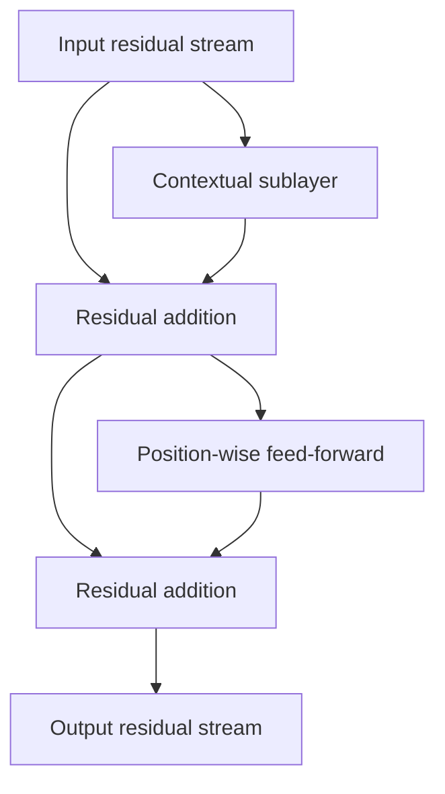
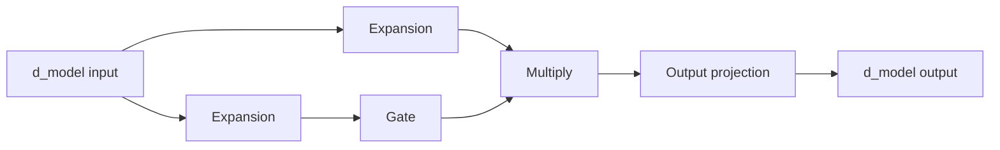
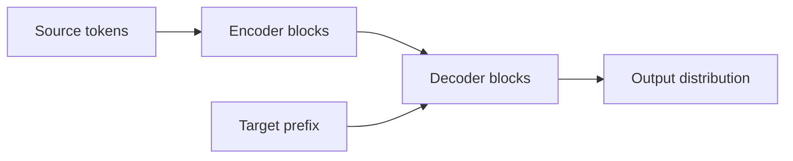
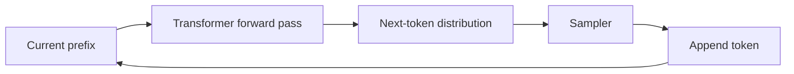
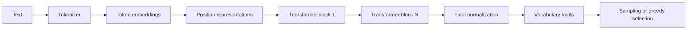

# Transformer Architecture

A Transformer is a neural network architecture for mapping a sequence of representations to another sequence of representations. Unlike a recurrent network, it processes positions through learned, content-dependent operations and can compute many of those operations in parallel.

The architecture became dominant because it combines three useful properties:

- **Parallel token processing:** many positions can be processed simultaneously during training.
- **Direct context paths:** attention provides a short path between distant tokens.
- **Compositional representation:** repeated blocks progressively mix local and global information.

**Key idea:** A Transformer is not an attention mechanism with embeddings attached. It is a stack of residual blocks in which token representations are repeatedly updated by contextual mixing and position-wise nonlinear transformation.

## The Residual Stream

Consider an input sequence represented by

\[
X \in \mathbb{R}^{N \times d_{\text{model}}},
\]

where \(N\) is the number of tokens and \(d_{\text{model}}\) is the width of the representation at each position.

The usual construction begins with:

\[
X^{(0)}
=
X_{\text{token}}
+
X_{\text{position}},
\]

where token embeddings and position representations are added before the first block.

Each block then reads from and writes to a shared sequence of residual vectors:

\[
X^{(\ell+1)}
=
X^{(\ell)}
+
F_\ell(X^{(\ell)}).
\]

The term *residual stream* describes this running vector at a particular position and layer. The attention and feed-forward sublayers add information to the stream; they do not replace it completely.



Residual connections help optimization by creating a direct path for gradients to reach earlier layers. They also make it possible for later representations to preserve information learned by earlier blocks.

## Core Transformer Block

A decoder-only Transformer block is commonly written as:

\[
Y
=
X+\operatorname{CausalSelfAttention}
\left(
\operatorname{Norm}(X)
\right)
\]

\[
Z
=
Y+\operatorname{FeedForward}
\left(
\operatorname{Norm}(Y)
\right).
\]

This is *pre-normalization*: normalization is applied before the sublayer, while the residual connection is applied outside it.

The full computation at position \(i\) is:

1. normalize the residual stream;
2. project it into attention queries, keys, and values;
3. compute a causal attention distribution;
4. update the residual stream with the attention result;
5. normalize the updated stream;
6. apply the feed-forward network independently to each token;
7. add the result back to the residual stream.

The following pseudo-code describes a pre-normalized causal block:

```python
# x: [batch, sequence, d_model]
normalized = rms_norm(x)
context = causal_self_attention(normalized)
x = x + context

normalized = rms_norm(x)
changes = feed_forward(normalized)
x = x + changes
```

The exact normalization type, activation function, and projection dimensions vary among model families, but this block structure is common.

## Attention Sublayer

In a decoder-only model, every block contains a self-attention sublayer. Given normalized input \(X_\ell\), the block obtains:

\[
Q=X_\ell W^Q,\qquad
K=X_\ell W^K,\qquad
V=X_\ell W^V.
\]

Attention first computes pairwise relevance:

\[
A
=
\operatorname{softmax}
\left(
\frac{QK^\top}{\sqrt{d_k}}+M
\right).
\]

Here, \(M\) is a causal mask for autoregressive decoding. The mask assigns \(-\infty\) to keys that occur after the current query. After softmax, such entries receive zero probability.

The attention output is:

\[
O=AV.
\]

A typical block uses multiple heads:

\[
\operatorname{MHA}(X)
=
\operatorname{Concat}
\left(
\operatorname{head}_1,\ldots,\operatorname{head}_H
\right)
W^O.
\]

Attention mixes information across positions. The feed-forward sublayer then transforms each position independently, using the same weights across the sequence but separate inputs at each position.

For a general comparison of query, key, and value organization, see [Attention](attention.md).

## Feed-Forward Sublayer

The feed-forward network, often called FFN or MLP, is applied identically to every position. A common gated implementation is:

\[
\operatorname{FFN}(x)
=
\left[
\operatorname{SiLU}(xW_g)\odot(xW_u)
\right]
W_d.
\]

Other variants use ReLU, GELU, or SwiGLU. The gating in the example creates a component-wise product:

\[
z=xW_u,\qquad
g=\operatorname{SiLU}(xW_g),\qquad
y=(g\odot z)W_d.
\]

The intermediate width \(d_{\text{ff}}\) is usually several times larger than \(d_{\text{model}}\). The network first expands the representation, applies a nonlinear activation or gating operation, and then projects it back:

\[
d_{\text{model}}
\rightarrow d_{\text{ff}}
\rightarrow d_{\text{model}}.
\]



Attention and the FFN perform different roles:

| Sublayer | Movement of information | Position coupling |
|---|---|---|
| Attention | Mixes information across tokens | Every position can read selected keys |
| Feed-forward | Transforms information within a token | Independent for each position |

Some mechanistic interpretations associate FFN dimensions with learned feature detectors or knowledge patterns, but a block as a whole is better understood through its end-to-end computation than through a claim that each neuron has an isolated semantic role.

## Normalization

Normalization stabilizes the scale of activations. Without it, repeated block updates can make residual streams increasingly large or cause unstable gradients.

### Layer Normalization

For one vector \(x\), LayerNorm computes:

\[
\operatorname{LN}(x)
=
\gamma
\odot
\frac{x-\mu}{\sqrt{\sigma^2+\epsilon}}
+
\beta,
\]

where \(\mu\) and \(\sigma^2\) are computed across the feature dimension. It learns scale \(\gamma\) and shift \(\beta\) parameters.

### RMSNorm

RMSNorm omits the mean-centering and learned shift:

\[
\operatorname{RMSNorm}(x)
=
\gamma
\odot
\frac{x}{\sqrt{\frac{1}{d}\sum_r x_r^2+\epsilon}}.
\]

RMSNorm has fewer operations and parameters than LayerNorm. Many modern decoder-only models use RMSNorm.

### Pre-Norm and Post-Norm

The original Transformer used post-normalization:

\[
X^{(\ell+1)}
=
\operatorname{Norm}
\left(
X^{(\ell)}+
F_\ell(X^{(\ell)})
\right).
\]

Modern Transformers more often use pre-normalization:

\[
X^{(\ell+1)}
=
X^{(\ell)}+
F_\ell
\left(
\operatorname{Norm}(X^{(\ell)})
\right).
\]

Pre-Norm usually makes deep networks easier to train because the residual stream itself remains mostly unnormalized. It can, however, allow activation scales to grow. Post-Norm is compatible with a final output normalization and may require careful initialization or learning-rate design.

Some architectures add normalization of the final residual stream before the language-model head.

## Encoder-Decoder Transformers

The original Transformer was an encoder-decoder architecture for sequence-to-sequence tasks.



### Encoder

An encoder block contains bidirectional self-attention and a feed-forward sublayer. An encoder token can attend to all source tokens:

\[
A_{\text{encoder}}
=
\operatorname{softmax}
\left(
\frac{QK^\top}{\sqrt{d_k}}+M_{\text{pad}}
\right).
\]

Padding tokens should not contribute meaningful information. A padding mask excludes them from key positions and is also responsible for masking positions that could otherwise mix padding state into valid tokens.

Encoder representations are contextualized by the entire source sequence.

### Decoder

A decoder block has more sublayers:

1. causal self-attention over the target prefix;
2. cross-attention from target queries to encoder outputs;
3. a position-wise feed-forward network.

The cross-attention computation is:

\[
Q=X_{\text{decoder}}W^Q,
\qquad
K=X_{\text{encoder}}W^K,
\qquad
V=X_{\text{encoder}}W^V.
\]

\[
\operatorname{CrossAttn}
=
\operatorname{softmax}
\left(
\frac{QK^\top}{\sqrt{d_k}}
+M_{\text{enc}}
\right)V.
\]

The queries come from the target sequence, while the keys and values come from the source encoding.

### Decoder-Only Transformers

Modern language models usually use a decoder-only stack with causal self-attention. Instead of maintaining separate source and target sequences, all inputs and desired outputs are represented in one token sequence.

For example:

```text
[system] Answer the question.
[user] What is a Transformer?
[assistant] A Transformer is...
```

Special tokens mark roles or turn boundaries. The model is trained to predict the next token given only earlier positions.

Decoder-only architectures are a strong default for text generation because the same stack can implement prompting, completion, in-context learning, and tool-use formatting.

## Position and Context

Attention has no inherent token order. The model therefore needs position information from:

- learned absolute positional embeddings;
- sinusoidal or fixed position embeddings;
- relative position representations;
- rotary position embeddings;
- attention biases such as ALiBi;
- combinations of these mechanisms.

For details, see [Positional Embeddings](positional-embeddings.md).

The position representation enters the model before the initial attention projections or directly into the attention score. Both choices affect how content and distance interact.

For a sequence of length \(N\), standard attention creates a score for every query-key pair:

\[
S\in\mathbb{R}^{N\times N}.
\]

It is therefore quadratic in sequence length with respect to memory and pairwise computation. In practice, implementation details and efficient kernels determine whether the matrix is materialized explicitly.

## Parameter Count

A block contains parameters in attention projections, the output projection, normalization, and the feed-forward network.

For standard MHA with model width \(d_{\text{model}}\), four main attention projections have:

\[
3d_{\text{model}}^2
+d_{\text{model}}^2
=4d_{\text{model}}^2
\]

parameters, if Query, Key, and Value all have dimension \(d_{\text{model}}\).

For an FFN with a simple two-projection network:

\[
W_\text{up}\in\mathbb{R}^{d_{\text{model}}\times d_{\text{ff}}},
\qquad
W_\text{down}\in\mathbb{R}^{d_{\text{ff}}\times d_{\text{model}}}
\]

the parameter count is:

\[
d_{\text{model}}d_{\text{ff}}
+
d_{\text{ff}}d_{\text{model}}
=
2d_{\text{model}}d_{\text{ff}}.
\]

A gated FFN has three matrices and therefore uses more parameters for the same intermediate width.

Including only dominant dense matrices, the parameters per block are approximately:

\[
P_{\text{block}}
\approx
4d_{\text{model}}^2
+
2d_{\text{model}}d_{\text{ff}}.
\]

For \(L\) blocks:

\[
P_{\text{model}}
\approx
LV
+ 
Ld_{\text{model}}
+
L(4d_{\text{model}}^2+2d_{\text{model}}d_{\text{ff}})
\]

plus final-head parameters, depending on whether the vocabulary head is tied to the token embedding matrix.

### A size example

For \(d_{\text{model}}=4096\), \(d_{\text{ff}}=16384\), and \(L=32\):

\[
P_{\text{attention}}
\approx
32\times4\times4096^2
\approx 2.147\times10^9,
\]

\[
P_{\text{FFN}}
\approx
32\times2\times4096\times16384
\approx 4.295\times10^9.
\]

The block stack alone is therefore on the order of 6.4 billion parameters, before the embedding table and additional heads or expert parameters are included.

These calculations provide estimates, not exact counts. Real implementations contain biases, normalization parameters, embeddings, rotary buffers, MoE experts, adapters, and model-specific projections.

## Training

Training a decoder-only Transformer for next-token prediction minimizes negative log-likelihood:

\[
\mathcal L
=
-\frac{1}{N}
\sum_{i=1}^{N}
\log P_\theta(t_i\mid t_{<i}),
\]

where \(t_i\) is the target token and \(t_{<i}\) is all previous tokens.

The prediction for position \(i\) passes through a final normalization and vocabulary projection:

\[
H
=
\operatorname{Norm}(X^{(L)})
\]

\[
l_i
=
H_iW_{\text{vocab}},
\]

\[
P(t_i=j\mid t_{<i})
=
\frac{\exp(l_{ij})}
{\sum_k\exp(l_{ik})}.
\]

This computes one distribution for every position in the batch. Causal masking ensures that the prediction at position \(i\) cannot see positions \(i\) or later.

### Why Causality Enables Parallel Training

Although generation is sequential, teacher-forced training can evaluate all positions of a sequence in parallel. Every target token is known, and causal attention makes each prediction depend only on earlier positions.

The training data still appears to be full sequences. The loss is typically masked for padding and may be masked for system prompts or untrusted regions according to the training objective.

### Scaling and Optimization

Transformer training uses optimization techniques such as:

- Adam or AdamW;
- cosine or warmup-stable learning-rate schedules;
- weight decay;
- gradient clipping;
- mixed-precision or low-precision training;
- tensor, pipeline, or data parallelism;
- activation checkpointing;
- packed or variable-length sequences.

The best configuration depends on batch size, model size, hardware topology, and the objective. For example, increasing batch size may improve hardware utilization but reduce noise diversity or require rescaling learning rates.

## Autoregressive Generation

During generation, the model predicts the next token from the current sequence, appends the prediction, and repeats:

\[
t_{n+1}
\sim
P_\theta(\cdot\mid t_1,\ldots,t_n).
\]



Common sampling strategies include:

- **Greedy decoding:** choose the highest-probability token.
- **Temperature:** reshape the logits before softmax.
- **Top-\(k\):** retain the highest \(k\) probabilities.
- **Top-\(p\) or nucleus:** retain the smallest set whose probability reaches \(p\).
- **Beam search:** retain multiple candidate prefixes for a sequence-level objective.

A temperature \(\tau\) scales logits:

\[
P_\tau(j)
=
\frac{\exp(l_j/\tau)}
{\sum_k\exp(l_k/\tau)}.
\]

For \(\tau<1\), the distribution becomes sharper. For \(\tau>1\), it becomes more uniform.

### KV Cache

During causal generation, previously computed Keys and Values do not depend on future tokens. The model can cache them and calculate attention only for the newly generated token.

Without a KV cache, every generation step recomputes all earlier positions. With a cache, the current step computes:

\[
Q_n,\qquad K_n,\qquad V_n,
\]

appends \(K_n,V_n\) to the cache, and attends:

\[
\operatorname{Attention}
(Q_n,[K_{\le n}],[V_{\le n}]).
\]

Approximate cache memory is:

\[
2LBGd_k,
\]

for batch size \(B\), sequence length \(L\), cache groups \(G\), and head width \(d_k\). MQA and GQA reduce \(G\), which reduces KV-cache memory.

The cache is not only a performance mechanism. It is a part of the serving architecture: cache capacity determines maximum concurrent context, and poor page layout can produce memory fragmentation or limit throughput.

## Mixture of Experts

A dense Transformer applies the same FFN parameters to every token. A Mixture-of-Experts (MoE) Transformer replaces the dense FFN with several experts and a learned router.

For token representation \(x\), the router computes expert logits:

\[
r=\operatorname{softmax}(xW_r).
\]

The model selects a subset of experts and combines their outputs:

\[
y
=
\sum_{e\in E}
g_e(x)\operatorname{Expert}_e(x),
\]

where \(g_e(x)\) is the router weight for selected expert \(e\).

MoE increases total parameter count without applying every expert to every token. It can therefore improve model capacity while keeping per-token compute lower.

The trade-offs are substantial:

- routing must be stable and balanced;
- experts need distributed storage and communication;
- unused or overloaded experts can become ineffective;
- serving requires more memory even if compute is sparse;
- expert parallelism introduces synchronization and transport costs.

## Efficient Transformer Designs

The standard attention score matrix grows quadratically with sequence length. Several approaches change the block or attention pattern:

- **Sliding-window attention:** each token attends to a bounded neighborhood.
- **Global tokens:** selected tokens provide long-range bridges.
- **Sparse attention:** predefined or learned patterns reduce pairwise computation.
- **Linear or kernel attention:** reorder or approximate dot-product attention.
- **State-space layers:** maintain compressed sequence state with linear or near-linear processing.
- **FlashAttention:** avoid materializing the full attention matrix while preserving the attention result.

Efficient implementations should be distinguished from efficient approximations:

- FlashAttention changes memory access and kernel organization, not the central softmax formula.
- Sparse attention changes which pairwise terms are eligible.
- Kernel attention changes or approximates the similarity computation.
- Sliding-window attention restricts context directly.

## Position in the Generation Pipeline

For an end-to-end language model, a Transformer block is only one stage:



Tokenization, positional encoding, block stack, output projection, and sampling form a complete generation system. Errors or mismatches in one stage can invalidate the rest: a tokenizer change usually requires a matching embedding and vocabulary head, while a different context format can alter positional and attention behavior.

## Why Transformers Work

A Transformer succeeds not because attention alone is a complete model of language, but because the whole residual architecture supports several forms of composition:

- **Indirect memory:** every token can gather context through learned pairwise relationships.
- **Local and global patterns:** shallow blocks can capture nearby structure while deeper blocks combine wider context.
- **Parallel computation:** attention and feed-forward operations use dense matrix multiplication.
- **Compositional updates:** residual blocks refine rather than replace representations.
- **Learned feature extraction:** each block can produce features useful to later blocks.
- **Generative interface:** causal masking and a vocabulary head reduce language modeling to next-token prediction.

As depth and width increase, these mechanisms become distributed across many heads and positions. Individual components are rarely sufficient for a complete explanation, and the same model may represent a behavior through combinations of attention heads, residual features, FFN features, and normalization.

## Practical Checklist

Before choosing or debugging a Transformer, examine:

- the model dimension and head width;
- the number of heads and Key-Value sharing strategy;
- the feed-forward expansion factor and activation;
- the normalization placement;
- positional encoding and effective context limit;
- causal, bidirectional, or cross-attention masking;
- padding and batch packing behavior;
- KV-cache memory and serving concurrency;
- the language-model head and vocabulary tying;
- mixed-precision and numerical stability;
- attention kernel and sequence-length implementation;
- MoE routing and expert placement, if applicable.

For most inference systems, correctness first depends on matching tokenizer, context layout, position handling, and attention masks. Performance then depends on memory traffic, KV-cache utilization, kernel efficiency, and parallelism.

## Summary

A Transformer is a stack of residual blocks combining contextual attention and position-wise transformation:

\[
X_{\ell+1}
=
X_\ell
+
\operatorname{FFN}
\left(
\operatorname{Norm}
\left(
X_\ell+
\operatorname{Attention}
\left(
\operatorname{Norm}(X_\ell)
\right)
\right)
\right).
\]

The attention sublayer routes information across positions. The feed-forward sublayer transforms information at each position. Residual connections preserve a stream of accumulated information across depth, while normalization stabilizes each sublayer.

From token embeddings to residual updates, the Transformer is a differentiable sequence processor whose behavior emerges from the interaction of all these components across many layers.
